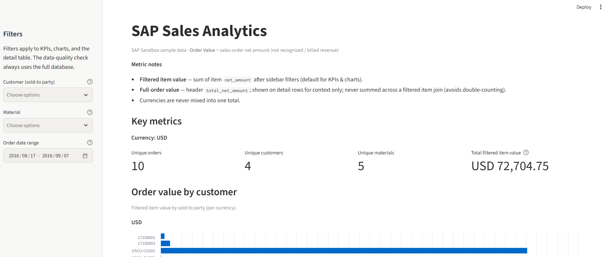

# SAP Sales Analytics

Python learning lab that ingests **SAP Sales Order** data from the Business Accelerator Hub sandbox (OData V2), lands raw JSON, normalizes headers/items into **DuckDB**, and explores the result in a read-only **Streamlit** dashboard.

Order Value in the UI is **sales-order net amount**, not recognized revenue / billing / FI postings.

> No live SAP API calls are required to explore the layout, run unit tests, or open the dashboard against a local DuckDB file. Wire a sandbox API key only when you are ready to ingest.

## Stack

- Python 3.11+
- `requests` — HTTP client (GET only)
- `python-dotenv` — secrets from `.env`
- DuckDB — local analytical store
- Streamlit + pandas — interactive dashboard
- `pytest` — unit tests (no network)

No Airflow, Spark, Docker, Kubernetes, or cloud infra.

## Project layout

```text
sap-sales-analytics/
  app.py                 # Streamlit dashboard (read-only DuckDB)
  src/
    sap_client.py        # Sandbox GET client (APIKey, timeout, retries)
    ingest.py            # Fetch + save raw JSON under data/raw/
    transform.py         # Normalize JSON → DuckDB tables
    sorting.py           # Natural sort for sales_order / sales_order_item
  tests/
    test_transform.py
    test_sorting.py
  docs/
    ui-dashboard.png     # Example Streamlit UI screenshot
  data/raw/              # Raw API JSON landing zone (gitignored contents)
  sql/                   # DDL sketches
  .env.example
  requirements.txt
  README.md
```

## Setup

```bash
cd sap-sales-analytics
python3.11 -m venv .venv
source .venv/bin/activate          # Windows: .venv\Scripts\activate
pip install -r requirements.txt
cp .env.example .env
# Edit .env and set SAP_API_KEY only if you plan to call the sandbox
```

## Ingest & transform

Ingest writes raw JSON under `data/raw/` (requires a valid sandbox key when live calls are enabled):

```bash
python -m src.ingest
```

Transform reads raw JSON into DuckDB (`data/sales_analytics.duckdb` by default, gitignored):

```bash
python -m src.transform
```

Tests (offline):

```bash
pytest -q
```

### SAP sandbox patterns

Host (typical):

```text
https://sandbox.api.sap.com/s4hanacloud
```

Service path:

```text
/sap/opu/odata/sap/API_SALES_ORDER_SRV
```

Auth: `APIKey` header from Business Accelerator Hub → your sandbox application.

| Purpose | Method | Relative path |
| --- | --- | --- |
| Sales order headers | `GET` | `/A_SalesOrder` |
| Items for one order | `GET` | `/A_SalesOrder('{SalesOrder}')/to_Item` |

Design rules: GET only; API key never hard-coded or logged; timeouts + retries; identifiers as strings; OData `/Date(...)/` → timestamps; money as `Decimal`; header/item validation.

## Streamlit dashboard

Read-only POC over `data/sales_analytics.duckdb`. Filters by customer, material, and order date. KPIs and charts stay **currency-safe** (never sum across currencies) and avoid double-counting header totals when items are joined.

```bash
streamlit run app.py
```

Windows (venv):

```powershell
.\.venv\Scripts\python.exe -m streamlit run app.py
```

### Screenshots

Streamlit UI — KPIs and Order value by customer (sandbox sample data):



### Order Value vs revenue

- **Order Value** = sum of item `net_amount` (sales-order net), optionally scoped by filters.
- Header `total_net_amount` is shown for context only; it is **not** summed on the join (that would double-count).
- Material filters use **filtered item value**, not the full header amount.
- This is **not** recognized revenue, billing document value, or FI posting amount.

### Sales order ID sorting

`sales_order` and `sales_order_item` stay **VARCHAR/string** everywhere (DuckDB, joins, filters, UI). For display order, use natural numeric sorting via `src/sorting.py`:

```sql
ORDER BY TRY_CAST(sales_order AS BIGINT) NULLS LAST, sales_order
```

Numeric-only IDs sort as 1, 2, 10, 13 (not lexicographic 1, 10, 13, 2); leading zeros are preserved in display; non-numeric IDs sort lexicographically after numeric ones. Dashboard detail and data-quality tables use `sql_natural_id_order()`; pandas helpers are available for future dataframes.

### Sandbox sample data

SAP Hub sandbox payloads are sample/demo data. Counts, customers, materials, and amounts will not match a real S/4HANA tenant. Treat charts as illustrations of the pipeline and UI, not production analytics.

## Secrets hygiene

- Credentials live only in `.env` (gitignored). Use `.env.example` placeholders.
- Never commit `.env`, DuckDB databases (`data/*.duckdb`), or raw JSON under `data/raw/`.
- The HTTP client logs status codes/URLs without the API key value.
- Rotate the sandbox key if it is ever exposed.
